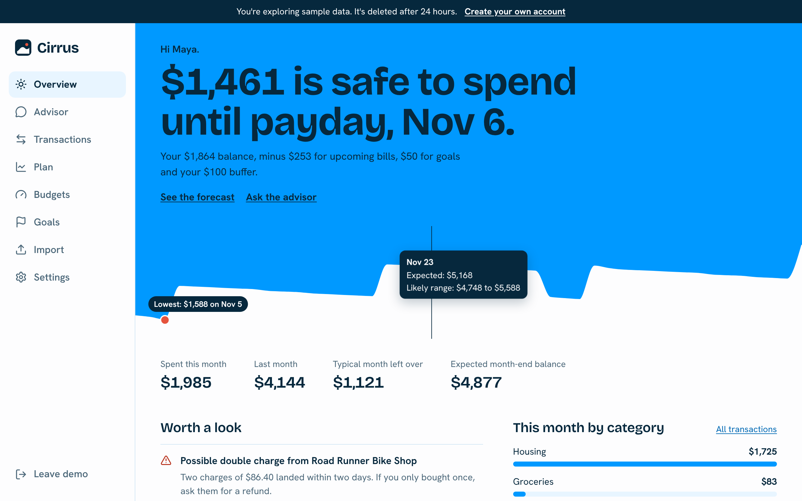
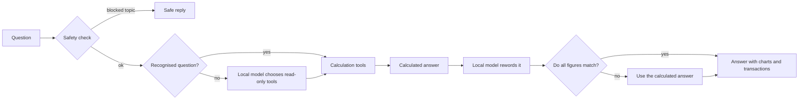
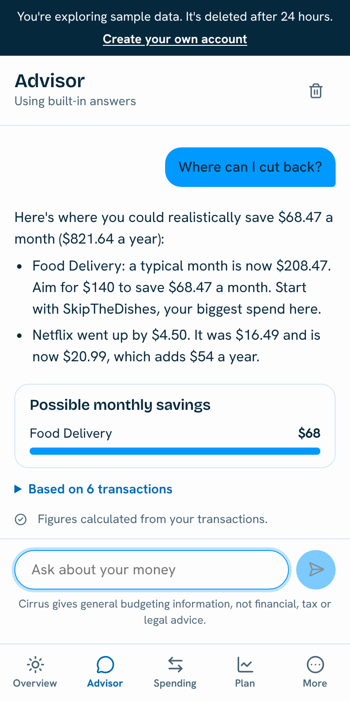

# Cirrus

A personal finance advisor that reads your bank statements, forecasts your balance and gives budget tips you can trace back to real transactions. It runs on a free local AI model, so there are no API bills and your statements don't go to an outside AI company.



## Why it's different

Most finance chatbots ask a language model to read your data and do the sums. Models get arithmetic wrong, and with money that's the one thing you can't have.

In Cirrus, **code calculates every number and the AI only helps with wording**. A verifier then checks each figure in the AI's reply against the calculations. If a figure doesn't match, Cirrus asks once more, then falls back to the calculated answer.



This design has a useful side effect: **Cirrus works with no model at all**. If Ollama is off, busy or still downloading, people get the same correct numbers in plainer language.

## Features

| | |
|---|---|
| **Smart statement import** | CSV and PDF, with a preview before anything is saved. Handles messy dates and amounts, cleans merchant names, categorizes, removes duplicates and learns from your corrections. |
| **Grounded advisor** | Plain-language answers with inline charts, plus the exact transactions behind them. |
| **Personal budgets** | Targets come from your own history. Fixed bills are covered, flexible spending moves toward your better months, and occasional costs become a monthly set-aside. |
| **Proactive insights** | Double charges, unusual purchases, price increases, slow category creep and subscriptions you may have forgotten. |
| **Cash flow forecast** | A 45-day balance projection with a likely range, your lowest point and an amount that's safe to spend. It also holds back money for bills due just after payday. |
| **What-if simulator** | Try cutting a category or cancelling a subscription, and see the next 12 months change. |
| **Affordability checks** | Ask "Can I afford a $1,500 trip by March?" and get an answer that keeps a cushion and respects your goals. |
| **Goal tracking** | Savings plans funded from your real surplus, with the earliest deadline first. They re-balance as your spending changes. |
| **Demo mode** | A year of realistic sample data with no sign-up, deleted automatically after 24 hours. |
| **Accounts and privacy** | Argon2 password hashing, revocable sessions, password reset, data export and permanent deletion. Personal details are masked before text reaches a model. |



## Run it

You need [Docker](https://docs.docker.com/get-docker/). Nothing else, and no API keys.

```bash
git clone https://github.com/Sarim1112/Cirrus.git
cd Cirrus
cp .env.example .env
docker compose up --build
```

Open <http://localhost:3000> and choose **Try the demo**.

The first run downloads the AI model in the background, which is about 2 GB. Until it finishes, the advisor uses its built-in answers, then switches over by itself. To skip AI entirely, set `CIRRUS_AI_ENABLED=false` in `.env` and run `docker compose up --build db api web`.

To try an upload, use the files in [`samples/`](samples).

### Choosing a model

The default is `llama3.2`, which is small enough to run on a typical laptop's CPU. Replies take longer on a CPU. If you have a GPU, a larger model that supports tool calling will write better answers. Set `OLLAMA_MODEL` in `.env`, and see the [Ollama library](https://ollama.com/library) for options.

To measure a model against the same questions as the test suite:

```bash
cd backend
python -m evals.run --live --model llama3.2
```

## Develop without Docker

You need Python 3.12+, Node 22+, PostgreSQL 16 and, optionally, [Ollama](https://ollama.com).

```bash
# Database
createuser cirrus --pwprompt   # password: cirrus
createdb cirrus --owner cirrus

# API, on port 8000
cd backend
python -m venv .venv && source .venv/bin/activate
pip install -e ".[dev]"
alembic upgrade head
uvicorn app.main:app --reload

# Website, on port 3000, in a second terminal
cd frontend
npm ci
npm run dev

# Optional: the local model, in a third terminal
ollama pull llama3.2
ollama serve
```

API documentation is at <http://localhost:8000/api/docs>.

## Tests

```bash
cd backend
pytest                # unit, API and security tests
python -m evals.run   # advisor accuracy
ruff check . && ruff format --check .

cd ../frontend
npm run lint && npm run build && npm run typecheck
```

The tests include:

- **Accuracy evals.** Expected answers are worked out from the raw sample statement with plain arithmetic, sharing no code with the analytics engine. That way an engine bug can't agree with itself.
- **A lying model.** A fake model changes every digit it's given. No altered figure may ever reach the user.
- **Data isolation.** A second user tries to read and change the first user's data through every route.
- **Prompt injection.** Instructions hidden in a merchant name can't change the numbers, and a model only has read-only tools.

GitHub Actions runs all of this against PostgreSQL on every push.

## How it's built

```
backend/app/
  ingest/    Statement parsing, merchant cleaning, categorizing and de-duplication
  engine/    Pure financial calculations, with no database, network or AI access
  advisor/   Safety checks, question routing, tools, the Ollama client and the verifier
  routers/   FastAPI endpoints
frontend/src/
  app/       Next.js pages
  components/ Charts and shared interface pieces
```

Next.js and TypeScript on the front, FastAPI and Python on the back, PostgreSQL for storage and Ollama for the model. Money is stored as integer cents throughout. More detail is in [docs/ARCHITECTURE.md](docs/ARCHITECTURE.md).

## Putting it online

See [docs/DEPLOYMENT.md](docs/DEPLOYMENT.md) for a production setup with HTTPS, and a launch checklist. Read [SECURITY.md](SECURITY.md) before you store real people's financial data.

## Limits

- PDF layouts vary widely between banks, so PDF import is best effort. The preview lets people check the result, and CSV is more reliable.
- Merchant and category rules lean toward Canadian and US merchants. Corrections are remembered per user.
- Recurring detection needs about three months of history. Forecasts assume your recent patterns continue.
- Each account uses one currency, and there's no live bank connection yet.

## Roadmap

Live bank sync through a service such as Plaid, receipt scanning, and an advisor memory that users can view and edit.

## Disclaimer

Cirrus gives general budgeting information, not financial, tax, legal or investment advice.

## License

[MIT](LICENSE)
